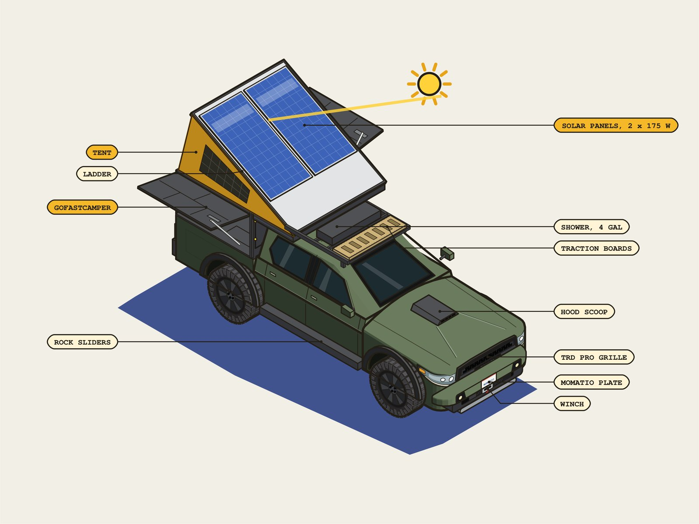

# Changelog

Every release of the live game, newest first. Play it at **[momatio.com/dispersed3d](https://momatio.com/dispersed3d/)**.

## October 24, 2026, 6:06 PM: The desert week, a new start picture, and no brand names

- This week's four-night trip is near Quartzsite, Arizona, on Bureau of Land Management land: the Montana forests had rain and snow in Monday's forecast, and we never send you camping in snow
- On that trip the town pump fills 10 gallons, so the drive home and the back half of the week matter
- The start picture is shot from the truck's other side, with the fire beside its sign instead of in front of it, on a computer and on a phone
- The overland gear on your rig is named by what it is, not by brand: pop-up camper shell, 12 V fridge/freezer, lithium batteries, battery monitor
- A first look at a second rig, an army-green 4x4 van, as a drawing you can turn and pull apart: [momatio.com/dispersed3d/rig/van/](https://momatio.com/dispersed3d/rig/van/)

## October 24, 2026, 12:58 AM: Your rig on the start screen

- The start screen shows your rig: a picture of the truck with its overland gear pulled apart and named, and See your rig opens the drawing you can turn
- On the start screen the tent pick now reads Your tent

## October 24, 2026, 12:06 AM: Your rig, and an easy way back

- Dave's rig is now Your rig, ready for more vehicles later
- The drawing has a clear Back to the game button at the top, and your browser's Back button closes the drawing and keeps you in your trip

## October 23, 2026, 10:48 PM: Dave's rig on every trip

- Dave's rig, the drawing of his truck and its gear, now opens on a challenge trip too (More, then Dave's rig, while the truck is stopped), not only in free play. The clock waits while it is open

## October 23, 2026, 9:06 PM: The truck drives smoothly

- Steering eases in like a wheel and comes back to center when you let go, instead of snapping to a full turn the moment you press a key. At road speed a full turn is gentler, and a quick tap is a small correction
- The truck no longer turns while standing still, and backing up steers the way a real truck does
- Leaving the road slows you smoothly instead of all at once, and a slope off road no longer drops you to a crawl
- Letting go of the gas coasts gently, and the brake is firmer than coasting
- On a phone, the stick is proportional: a light push drives slowly
- Mouse turns ease out instead of stopping dead

## October 23, 2026, 6:21 PM: Wash your hands at camp

- At a made camp, set up the hand-wash station: the 2-gallon jug and the soap go on the camp table. Then Wash your hands appears, about a quart a wash. The station is camp gear, so pack it up before you drive on
- A new habit on the trip card: Washed your hands at camp every night. Dave carries this jug and has never gotten sick in the backcountry
- The hand-wash jug is its own water, apart from the drinking jug and the roof shower tank, and a town run with water fills it too

## October 23, 2026, 5:55 PM: The hand-wash jug joins Dave's rig

- Dave's rig (More, then Dave's rig) now shows the 2-gallon hand-wash jug with its spigot and the soap beside it, under Break out with the other overland add-ons. Dave carries it to wash his hands at camp and has never gotten sick in the backcountry

## October 23, 2026, 4:33 PM: Town fills the roof tank too

- When you get water in town, the roof shower tank fills along with the jug, the way Dave does it. The town list's water line shows both

## October 23, 2026, 3:47 PM: The shower has its own water

- The hot shower now draws from the 4-gallon tank on the roof rack, 2 gallons a shower, the same as on Dave's rig. Your drinking water stays in the jug, and a trip gets two hot showers before the roof tank is empty

## October 23, 2026, 10:48 AM: REAL says where it comes from, and the road to town

- Tap a REAL badge and it says, in one line, which public source that fact comes from, and opens that source's entry on the What is real page
- Five words explain themselves on a tap: dead out, dispersed, MVUM, Red Flag Warning and stay limit
- Going to town rides the real road out of camp toward the pump for a few seconds, with its miles and gallons. Tap to skip it
- The morning card says what you slept on: how far off level the truck sat, and how far away the level spot was
- In the desert, a dry wash no longer fills your jug

## October 23, 2026, 7:44 AM: The sun over your ridge, and the creek in real numbers

- The morning card says when the sun cleared your camp's own ridge and toward which named summit, and how late that was against a flat horizon's sunrise. The ridge comes from the elevation map and the summit's name from the federal place-name record
- Where the USGS has a stream gauge on your camp's creek, the walk to the water, the filter and the dip quote its real flow and height, how far away the gauge is, and how long ago it was read

## October 23, 2026, 6:49 AM: A hot shower, and a walk from every camp

- On a sunny afternoon at camp, take a hot shower off the roof tank: 2 gallons and 10 minutes. The game won't let you if the jug couldn't then cover tonight and putting a fire out, and it reminds you to carry the soapy water at least 200 feet from the creek
- Filtering water at the creek now fills your jug
- Every walk to the same water takes the same minutes, worked out from the distance at a walking pace
- Once you've packed the cans and foil out of a fire ring, it stays clean for the rest of your trip
- The short loop on foot, once offered only at trailhead camps, is now offered at every camp by day where the ground allows one. The path is the game's, not a mapped trail, and the turnaround names a real summit you can see
- The camp dashboard's buttons use the same names as the evening card: Start a fire, Level the rig, Settle in for the night
- The tent you leave to hold your site is now a small A-frame tent
- The lines about gas name the station the route really goes to
- When the forecast on file is out of date, the game says which days it covers instead of saying nothing
- The morning reads the same wherever you stand: Morning after night 1 of 4

## October 23, 2026, morning: The rack load rides on your truck

- The truck you drive now carries the load from Dave's photos on its cab rack: a tan traction board across the front, then the flat black shower tank, then the camper
- The first-visit welcome on a phone fits the screen without scrolling

## October 23, 2026, early morning: A better night at camp

- The evening card opens with three big doors: Settle in for the night, Stay up and walk around camp, and Sit by the fire. The rest folds under More tonight
- On a night with no fire, whether it's banned or you just didn't light one, you can Sit out under the stars: the lantern on the table, the sky turning, the stars and the space station rising, until you get up or the sky goes gray
- Step out of the rig at a camp and the game tells you, once, what you'd notice on foot: how much the ground slopes where the camp sits, by the USGS lidar, and the water nearby and how often it runs
- A desert wash is called what it is: water the national map marks as running only part of the year says so on every walk, filter and dip, and in the desert it's a dry wash most days
- The morning card has a new line, Water and gas: what tonight and a fire will take from the jug, how far the creek is, how far the gas goes, and how far town is
- At some camps somebody left cans and foil in the fire ring. Now you can see them, and Pack out what somebody left clears them away
- When another party has the camp you were headed for, you now see it: their rig on the pad, tent up, and somebody gives you a slow wave as you come close
- Cook says what you made
- Dave's rig opens a little lighter: its drawing loads only when you open it

## October 23, 2026, after midnight: Dave's rig, fixed from his photos

- The camper's tent now opens the way Dave's does: hinged at the front, rising at the back over the tailgate
- The camper reaches forward over the cab roof. That's what makes the bed long enough for an adult to sleep in
- On the cab's rack, front to back: one traction board turned across the rack (Dave stacks the pair), the 4-gallon shower, then the camper
- The rear door handles moved to the back edge of the rear doors, where they really are
- The winch hidden in the front bumper shows through the lower opening, with its fairlead and hook
- The Dometic fridge in the back seat is drawn at its real size
- It's a 4WD truck, and now it says so: Drive shifts between 2H, 4 High and 4 Low with the rear locker, and you can watch the front shaft start turning

## October 22, 2026, evening: Dave's rig

- Stopped in the forest, More (the drawer on a phone) now has **Dave's rig**: the maker's own 2020 Tacoma TRD Pro, drawn by hand so you can turn it all the way around
- Pop the camper's tent, open its wings and put the sun on its panels to watch the power run to the fridge
- Drive it, or shift into 4 Low and lock the rear differential
- Break it out two ways: the factory parts from the V6 back to the rear axle, or the overland gear pulled away from the truck, every part named
- Later that evening: with the gear broken out, the batteries' label points at the nearer battery from any side, and the sun's ray reaches the panels without crossing the ladder
- The game waits while it's open

## October 22, 2026, noon: A cab drawn from a real truck

- The inside of the cab is redone from photos of Dave's own Tacoma: a dusty charcoal dash with a defroster grille, the gauge hood and the top of the wheel, the center stack, wide windshield pillars, the headliner with its map lights, and matching doors with armrests and window switches
- A folded paper road map and binoculars ride on the passenger seat
- Dead ahead the road stays clear, and at night the cab goes dark with the light outside
- Save the dawn leaves the cab out of your clip, so the sky stays clear

## October 22, 2026, morning: The run to town

- On a four-night trip, Go to town and back opens a list you tick: gas, water, groceries, dump the garbage, and a meal or a coffee, each with its own minutes
- Before you leave, it adds up the drive and the errands and says when you'd be back, and warns you in amber if that's after dark
- You start with three days of food. Each night uses one, and groceries fill it back up
- Every night makes a bag of garbage, and town is the only place it goes. The trip card has a new row: Packed out your garbage
- Gravel and dirt roads burn more gas than pavement, so crawling to a far camp costs you
- On a phone, the pulled-up drawer fits on the screen again with nothing to scroll
- Starting over is clearer: a new game now opens with "A fresh start" instead of "Welcome back", and Title in the middle of a game offers Start a new game. Your last game waits under Continue

## October 22, 2026, overnight: Before you settle in

- While you're stopped, one line under the clock shows the trip so far: which night of four, and the gas and water left
- Settling in before the tent is up and the food is stowed now asks first, once a night
- The night card opens on Before you settle in and the chores, with the camp's record and rules below
- Help opens on a five-line Quick start in the game's own button names
- After four nights, one picture of your trip card with the gas and water left, to save or share
- Where a forest posts a real food order, the morning card names it
- The level card is called Level the rig, the morning says Morning after night 1 of 4, and the fourth morning warns before packing up ends the trip

## October 21, 2026, afternoon: The inside of the cab

- From the driver's seat you now sit inside the truck: a dash with a lip, thin windshield pillars, doors with a window ledge and an armrest, and the roof edge
- Look out the passenger window and you see the window, the door and the dash, the way you would in a real truck, instead of a flat edge of hood
- Dead ahead the view is unchanged, and at dusk the cab goes dark with the light outside

## October 21, 2026, early morning: A driver's seat that feels like one

- The hood stays bolted to the truck and level, whichever way you look
- From the driver's seat you can turn your head to either side window and nod a little, but not stare at the ground; on foot you can still look anywhere, all the way around and down at your feet
- Moving the mouse to a button or a panel no longer swings the view on the way there: the view turns when the cursor rests near an edge

## October 20, 2026, evening: A clear windshield while you drive, and map squares like a paper map

- Enjoy the ride is now the game's way for everyone: once you're rolling the screen clears, and a small arrow with the miles points to your camp
- The readings drop in when you ask: drag down from the top (or press I) and the clock, light left, fuel, water and miles to go show for a few seconds, then put themselves away
- Camp names wait until you ask for them: press Names (N on a computer)
- The map has squares like a paper map, letters across and numbers down, and each camp's label carries its square
- On a phone the letters and numbers sit outside the map's edge, so the map itself stays clear
- The title's Start button now says Play, which is what it does

## October 20, 2026, morning: Camp Cook, third pass, and a fairer trip card

- Camp Cook's pan looks more like the real thing: chunkier bell pepper pieces with charred edges, thinner and paler hash browns, whiter fat on the raw bacon and redder bacon once it cooks
- Broken out frames only the food that is in the pan at that step, so a few heaps fill the view instead of floating in a big empty space
- "Nothing left behind" is fair to a base camp: leave the camp clean on your last morning there and every night you spent at it counts as packed
- Filtering water at a camp's own creek now says plainly that it does not count toward "Water from a creek", which is for a creek the stream map shows running all year
- The same update is on davelalande.com's Camp breakfast scramble field note

## October 20, 2026, early morning: Camp Cook, sharper: real light and shadows, and food that looks like Dave's pan

- Camp Cook is lit for real: a warm morning sun and soft sky light on every surface, a shine on the peppers and the nonstick pan, and shadows the food casts on the pan and on itself
- The food looks like Dave's own pan: thin curved pieces of bell pepper, narrow curled bacon that browns as it cooks, golden shredded hash browns, onion slivers, jalapeño rings and soft egg curds
- A gray granite pan with white flecks, a rounded blue camp stove with a wire grate, and a wood table with real grain
- Sharper on a computer: the scene is drawn at twice the pixels, and it steps itself down if a computer can't keep up
- A level camp stays where the record has it: three camps that sit near their road but are level (Moser Road 6213, Auggie Cut-Off 04 and Crystal Hill) are back on their recorded spots instead of being moved 100 feet off

## October 19, 2026, late night: Camp Cook points to its recipe page, and keeping a forest for offline play survives a dropped connection

- The recipe in the game now links to the same recipe on davelalande.com, and the recipe page there links back to the game
- Keeping a forest for offline play no longer gives up on one dropped connection: a file that drops before any answer is asked for once more, so a weak signal does not throw the whole forest away

## October 19, 2026, night: Camp Cook: Dave's breakfast scramble in 3D, with every ingredient broken out

- Camp Cook, a recipe you can watch: Dave's camp breakfast scramble (bacon, hash browns, the week's bag of peppers, onion and jalapeño, then 3 eggs) cooks step by step on a one-burner stove, with what each step looks like when it is done
- Watch plays the whole recipe in about a minute; Cook along counts down each step's real minutes while you cook
- Broken out: the food lifts out of the pan like an exploded drawing, and every ingredient is labeled with one fact from USDA FoodData Central, with a link to its source
- What's in the pan: protein, calories, vitamin C, fiber and sodium add up as each ingredient goes in (about 29 g of protein by the end; the amounts are estimates and say so)
- In the game: Camp recipes in the phone's drawer and a Recipe link on the night's Cook line, only when the truck is stopped. The game pauses underneath and comes back exactly as it was
- On davelalande.com: the same recipe as a field note, Camp breakfast scramble, in the site's own colors
- It works with no connection in a forest you kept for offline play, and everything in the pan is drawn in code, so it stays light on a phone

## October 19, 2026, afternoon: Fixes from an AI's playtest, and a lighter game for computers with no graphics card

- An AI player played a four-night trip on Custer Gallatin overnight and wrote down everything that tripped it up; these are its fixes
- Night chores show what is done: each line has a check box, a ticked line says "done", and the card says plainly that ticking a chore spends its minutes on the game clock, once
- The morning reads like morning: the morning card is about last night's camp, with no advice about tonight's wind, and Real right now says "The sky now" by day and "Forecast for the coming night" from 6 AM to 6 PM
- Headlights go off after a night's sleep, and if they are on in full daylight one line says how to turn them off
- The road under the wheels has its real name: up Hyalite Canyon it said "Fowler Ln", a town street's name the street map carries along the Forest Service road. It now says Forest road 62
- The map keeps camp names apart: on a phone it names up to five camps instead of one, never on top of each other or the truck, with your goal camp and the camps you slept at named first
- Tonight's camp is a free camp whenever the forest has one, never a fee campground
- A computer that draws the 3D without a graphics card now opens the lighter game phones already get: fewer trees and a smaller photograph. Help, Settings puts the full game back
- A guard for the game clock: in that playtest it leapt three hours at the start of the trip. We could not make that happen again, so the clock now ignores a sudden jump in the computer's own clock, and we are watching for it

## October 19, 2026, morning: Camps off the road, on level ground

- Camps are off the road now: every camp has a spot where you would really park, and a Self Drive rolls down a short two-track spur and stops there, instead of parking on the road beside it
- A dispersed camp keeps the spot its record gives when that is 80 feet or more off the road; one closer than that moves to about 100 feet off, on dry, open ground away from other roads
- The spot is picked for level ground, scored the way the level card reads the truck's four wheels, so the card can usually help you level up
- Developed campgrounds keep their own loop road, and camps far out in the desert stay exactly where the record has them

## October 19, 2026, early morning: The real wetlands on the map, and rain that sounds like where you are

- Real wetlands on the map: zoom in and the wetlands the U.S. Fish and Wildlife Service mapped from aerial photographs show hatched in blue-green, with a key that says whose map it is. Their edges are approximate, and ground that looks dry can still be one
- The map zooms: Zoom in, Zoom out and Find me, down to about half a mile across. On a computer the mouse wheel zooms and a drag moves the map; on a phone, pinch
- Rain by place: in the truck or the rooftop tent it is the downpour on the roof over you, with drips off the trees; out on foot it is the same rain, more open and a little softer. Light rain stays light
- Behind the scenes: more for AI players, like seeing an AI's reasons as it plays and taking the wheel back from it. It is not open yet

## October 18, 2026, evening: The sound offer stays off the fire, and a reminder to stay on the mapped roads

- Sitting by the fire, the offer to turn the camp sound on now always moves off the fire. On a slow phone it could land right on top of the flames and stay there
- Stay on the mapped roads: the first time you park well off every mapped road and away from any camp, one line says so. Driving off the forest's vehicle map can earn a ticket, dry-looking ground can be a wetland, and the Road button points the way back. It is said once, never again
- The trip card is fairer: a fire lit and put out on the same day counts for that night, and Head for town now checks the camp the same way driving away does: a fire still going is put out and camp packed up first, and a clean leave counts as packed up
- Behind the scenes: more groundwork for AI players. It is not open yet

## October 18, 2026, midday: Lighter ground photos on phones, and a try-out of the enjoy-the-ride screen

- On a phone that can show compressed pictures, the ground photographs now take about a quarter of the memory they did (about 21 MB instead of 78), so the game runs easier. Computers and older phones keep the regular photographs, and the Info card says which you have and why
- A try-out of a calmer screen while you drive, from Dave's own idea: add ?ride=1 to the address. Camp names stay away until you ask for them, a small arrow with the miles points to your camp, a pull down from the top brings the clock, light, gas and water, and any line that pops up goes away by itself in a few seconds
- For people building AI players: add ?ai=1 and an AI can take the driver's seat. Self Drive does the driving, the AI makes the slow calls (which camp, gas and water, push on or wait), and touching the wheel hands it straight back to you

## October 18, 2026, morning: The hood stays with the truck when you look around

- Look around while you drive and the hood keeps pointing down the road, the way a real truck's does. Turn your head far to the side and it drops out of sight below the door and dash
- No more "The whole tile is now drawn at 3.2 m a step" popping up mid-drive. It was nothing you could act on, and the Info card still has the ground detail
- Pressing "Let time run fast" a second time no longer freezes the game: the clock stops at the hour the fast run reached

## October 17, 2026, late evening: The fire goes dead out before bed, and the game's lines take turns

- Settle in for the night with a fire lit or its coals still warm, and a card walks you through the Forest Service's steps first: drown it, stir it, feel for heat. You can still turn in and leave it burning, and the morning card says so honestly
- The game's lines take turns: a teaching line that comes up while you roll waits until you stop, a line that is no longer true is dropped, and a line never pushes another off the screen
- Every Self Drive starts with one line: how far, about how long, and whether you will get there in daylight or after dark
- The water jug says when it runs low and when it is empty, once each, with the real ways to fill it. Filling the jug, or a run to town, clears the warning
- Stay today is only on the morning card, and the evening buttons say what they do: Stay up and walk around camp, or Sit by the fire while the hours go by
- The four-night trip ends on its own card and shows which night you are on. On phones, nothing covers the open More drawer and the trip card's first line clears the Close button

## October 17, 2026, early morning: A clear windshield: nothing in the way while you drive

- About a second and a half after the truck starts rolling, the screen clears. Left in the corner: Info, the speed (x1, x4, x12) and Stop on a Self Drive, and only Info when you drive by hand. A message that matters shows as one thin line; the game's teaching lines wait until you stop. Info brings everything back while you roll
- Each night's note writes itself from what the game recorded, and you can change it; your words are kept as yours
- Dave's own way at the creek: Dr. Bronner's lavender (skeeters don't like it), 200 feet from the water. One gallon of water a day is his number from his trips
- Parked at camp with the engine off, at dusk or first light, a mule deer (an elk where elk live) may step to the edge of the clearing. It is the game's chance, said as the game's, not a sighting
- A new line on the night card: how long the sun is off this camp behind its own ridges (USGS ground), and how long the woodpile lasts
- Smoother edges on every phone, and fixes from a player who started cold: the clear windshield works after the first night too, old lines no longer pop up the next morning, and a fire that burned out on its own is never written up as put out with water

## October 16, 2026, afternoon: The game has a goal: a four-night trip in one forest, on limited gas and water

- "Four nights" sits beside "Tonight's camp" on the welcome: four nights in the Lolo on a quarter tank (6.5 gallons) and 5 gallons of water. The trip is saved for a week, so it can be one long sitting or four evenings
- The trip card has two lists. The trip's: four nights out, every fire put out with water, nothing left behind, and back to town with fuel. The overlander's: looked at camps you did not stay at, got out and looked on foot, shut the engine off and listened, held your site, three nights at the site you held, water from a creek, a cold dip with the soap 200 feet from the water, and left it better than you found it. Each row is checked or not; nothing is added up and nobody is ranked
- On the fourth morning, Head for town drives the real road miles to the gas station in Seeley Lake. Run the tank dry on the way and the trip ends, and says how many road miles were left
- Some fire rings hold cans and foil that somebody left. They are the game's, labeled as the game's, never a word about the real site; packing them out counts as leaving it better
- The season is judged camp by camp from each camp's own record, and a trip is refused only when every camp in the forest is closed
- On a phone the welcome's three buttons now fit the first screen, and on the Red screen the logbook's night squares and the REAL tags are red with black words

## October 16, 2026, early morning: The Weather Service's warnings for your camp, cold and wet nights, the fire that burned here, and gas back to town on real road miles

- When the National Weather Service posts a warning for the spot, such as a Red Flag Warning, a Wind Advisory or a Flash Flood Watch, the game quotes it with its date and the office that posted it. On a Red Flag day you are offered "No fire tonight": your choice to make and to take back, kept in the logbook. The game never refuses a fire on its own
- Where the forecast's own grid cell sits well above or below the camp, one sentence says so, so a forecast low is read for what it is
- Cold and wet nights from the forecast's own numbers: bring the water jugs in on a freezing night, crack the tent's vents when the dew point says the tent will be wet inside by morning, and park with the truck's tail to the wind
- The fire that burned here: when a camp sits inside a wildfire perimeter in the National Interagency Fire Center's history, the camp card names the fire, its year and its acres, with the date the record was read. The drive row says how far the road climbs and its steepest mile, from USGS elevation
- Gas back to town in road miles: the nearest gas station is found on OpenStreetMap and the road there is routed by the game itself, at the game's 13 mpg on pavement and 8 on dirt
- Footsteps on what the record says is under you (gravel, forest duff or sand), the coaching line read aloud by a screen reader, and a game pad or Steam Deck drives, steers and looks

## October 15, 2026, evening: The real dusk, the Moon's real face, the Milky Way as photographed, and a day at camp

- Dusk is now worked out by the game's own model of sunlight passing through the air, instead of a hand-picked table of colors: an orange band low over the real ridge, fading through lilac to blue after the sun goes down, and properly dark at night
- The Moon wears its real face, from NASA's Lunar Reconnaissance Orbiter map, lit by tonight's real phase, and at a dark camp the Milky Way is the European Southern Observatory's all-sky photograph, placed by the same clock as the stars
- A day at camp: the morning card offers "Stay today". The afternoon follows the Weather Service's real hours, the sun crosses camp and the truck's shade moves with it, and the evening ends at the real dark. What a day costs in water is the game's guess, labeled as one
- The Starlink dish, the traction boards and a steel pipe gate built in Momatio's Asset Lab replace the plain shapes, and the ground tent has canvas with seams
- On a phone, the truck shows its full finish while you are parked at camp, and on dirt roads dust builds up on the hood until the forecast's rain washes it off
- On a phone, smoother edges along tree lines and ridges can be switched on by adding &aa=1 to the game's address. It stays off until it has been tried on real phones

## October 15, 2026, afternoon: Stow the food where the Forest Service says so, rain on the tent, a creek that sounds like its gauge, and cliffs without streaks

- Where a forest's own alerts page posts a Food Storage Order, the night checklist gains "Stow the food: cooler and food in the truck", with the order's number, its dates and a link to the order. The game works out each camp's ranger district from the Forest Service's district map, so the chore says plainly when a camp is inside the area the order names; where the order's area cannot be placed, it says that too. Where no order is posted, nothing changes
- Rain on the tent: in the hours the National Weather Service forecast says rain, settled in or sitting by the fire you hear it, louder in the tent than by the fire. The sound is made by the game itself, not a recording, and stays off until you turn the sound on. The morning card says which hours it rained, by the forecast
- At the three camps on Hyalite Creek, the creek is louder when the USGS gauge reads higher than on your first night there and quieter when it reads lower, and the engine-off card says why, with the gauge's own height and the time it was read
- Steep faces no longer show long green and brown stripes where the overhead photo was stretched down the cliff: they take their color from the photo around them, and the rock grain shows
- On a phone, the second night in a forest offers once to put the game on your Home Screen: a button where the browser can install it, the Share steps on an iPhone
- On davelalande.com, the 22 camp pages the game holds now show the game's own picture of that camp before sunset, labeled as the game's view, and the game's day there: the fire rule, tonight's low and the creek gauge, each with its source

## October 15, 2026, morning: Wake for the pass after midnight, cliffs that read as rock, and a lighter visit after a phone runs out of room

- On a night when the space station, the newest Starlink train or a meteor shower's peak comes after midnight, the night card offers one more choice beside Wake for first light, such as "Wake for the 5:54 AM pass". You sleep as Settle in does and are woken 8 minutes ahead by the coals, facing where it comes up, with one line saying what it is and which way to look. Back to sleep, at the bottom, sleeps on to sunrise. The times are computed from CelesTrak's orbits and the International Meteor Organization's shower table for a clear sky, and a cloudy hour in the Weather Service's forecast is said, not hidden. On other nights nothing changes
- Bare ground the USGS elevation map measures as steep now shows a photographed rock surface, a free-to-use picture of other rock that adds grain and cracks; the federal aerial photo still sets the color. On phones too
- If a phone ran out of room last time, the next visit opens lighter (fewer trees, smaller ground photos, the extra shading off) and says so once. Help, Settings puts the full picture back, and two clean visits in a row put it back by themselves. If the 3D picture is lost, a Reload button shows instead of a black screen

## October 15, 2026, early morning: When the sun really leaves camp, tonight's low, and a level you can read

- Where a ridge to the west hides the sun early, the game now says when it goes behind that ridge and camp falls into shade, worked out from the USGS elevation map of bare ground (so the trees take a few more minutes). At Langohr in the Custer Gallatin on October 11 that is about 5:19 PM, almost an hour and a half before the almanac's 6:46 PM sunset. It is on the drive planner's arrival line, the camp dashboard's sky row and, once, at camp. A camp with an open sky to the west says nothing extra
- Tonight's low and the temperature at first light, from the National Weather Service's hourly forecast: the camp dashboard gives the night's coldest hour with its time, the morning card the forecast at first light, and a night under 40 degrees is said once as you make camp. Where the forecast has no hours for the night, it says nothing
- The level card draws the red T level straight down and large: both vials with their one-degree marks, a big bubble with a green rim when it is level enough and amber when it is not, and an arrow on the low end. On a phone the level, both readings and the verdict fit without scrolling
- On a phone the route strip keeps to the arrival time, the light and the gas, so it no longer pushes the captions down onto the thumb stick

## October 14, 2026, evening: Steering that keeps turning, real fire rings and a smoother first visit

- A, D and the arrow keys (and the stick, sideways) now turn the rig for as long as you hold them, at the rate a rig turns, and the view turns with the cab. Before, a held key stopped turning after about 34 degrees
- The campfire: a ring of real stones at a dispersed site, and the Forest Service steel ring with its grate where the camp's record says it is a fee campground; split firewood with bark that chars as it burns down, a cracked bed of glowing coals, and soft wisps of smoke that drift with the forecast wind
- A smoother drive: the first time you drive in among the trees a phone no longer stops for a second, and the game's warm-up now prepares the pictures the frame really draws
- A first visit opens on a forest that is open today, starts you on a mapped road near the first camp, highlights one camp to drive to, waits until you have stopped before opening the camp card (which then says You are here), and keeps the level card's button on the screen
- The Fire button on foot turns you to face the fire and keeps it centred
- Sharper ground and road surfaces seen at a slant, and the page itself is about 480 KB smaller to download (the notes and spacing in the game’s own code are taken out when it is built)

## October 14, 2026, afternoon: Bark up close, real road surfaces, gear shadows and the elk at dusk

- Up close the ground and the trees are real materials: bark and needles you can see, and a road whose record names its surface now wears it (gravel, native dirt or asphalt, from photographed materials) instead of one plain band
- The truck, the tent and the camp gear cast real shadows near the rig, and take them
- The bull elk at dusk, in the three Montana forests that have elk
- The best dark night of the next seven, named on the title and the morning card: the cloud is the Weather Service's sky cover, the Moon times are the game's own arithmetic. Your first evening is told in order, once
- See this spot for real: the game's view beside the USGS aerial photo. The Season Book's real trip prints, with links to each night's real forecast and town, and Plan the real trip opens davelalande.com/trip with the camps you slept at
- Every REAL badge is a link to its source on the What is real page, which now uses davelalande.com's own words for the five sources both share
- A lighter first visit: the graphics engine now loads as one compact file, about 490 KB less to download, and momatio's menu sits at the top of the game's own pages

## October 14, 2026, early morning: A quick start, wet roads after rain, and the night sky to share

- A short quick start right after Start: you are in a reconstruction of the real forest (USGS lidar ground, the USGS aerial photo), look for the REAL badges, the keys or stick, the Drive and Camp buttons, and your progress kept in this browser. Don't show this again is one tick
- After forecast rain the roads read wet: darker, little dust, puddles in the lidar's real dips, a splash over the hood, and more soft spots on rough roads while they dry. The forecast is the Weather Service's; the wet look is the game's reading of it
- At first light, fog in the low ground and dew on the hood when the forecast has the air near its dew point and calm; said as the game's inference
- The sky to share: tonight's space station and newest Starlink train passes with a heads-up, and a short clip of the dawn or a pass you can post
- Camp life: the dish's sky view from the real ridge and trees, an engine-off soundtrack of wind and creek, breaking camp the Forest Service way (dead out, tent down), and now and then another party's rig already in a spot, so you drive on
- A share link opens your friend's night, a returning title says what changed since last night, and each share page names its camp's record on davelalande.com, with Plan the real trip from your season

## October 13, 2026, early morning: Getting level, the camp page, and keys that drive

- At camp, getting level the way Dave does it: engine off, listen, then a two-vial level reading the real USGS lidar under your four wheels. Pull ahead, slide a traction board or a flat rock under a low wheel, or find flatter ground
- One Camp button, a quiet camped line at the top, and a camp page with your fire, water, fuel, level, tonight's sky and weather, and a REAL tag naming the source of every outside number
- No driving off with the fire lit: one card, put it out and pack up, or stay
- Keys drive on a computer and the thumb stick drives on a phone; the hold-to-drive button is gone. The mouse keeps steering past the edge of the picture. Auto is now Drive
- Dave's own truck with its real finish on a computer; Dave as the once-a-season camp neighbor, now his realistic model; and some evenings a deer on the road at dusk, the game's own deer

## October 12, 2026, evening: Lightning on stormy nights, Help as the About page, and sharper camp gear

- When the National Weather Service forecast calls for thunderstorms near you: flashes, strikes, thunder you can count, and the safe move, off the ridge and into the truck
- Help is now the About page: what the game is, that you are managing time, and the key map, with one small "New here?" note on a first visit
- The camp gear draws its real surfaces (worn paint, scratches, seams), with smaller pictures on phones, loaded as you reach camp
- Some nights, a sound at the edge of camp. The game does not pretend to know what it was
- The morning card counts your nights at a camp against the stay the record allows, and says when it is the general 14-day rule instead

## October 12, 2026, afternoon: Who else is out tonight, and a picture of each night

- When you make camp, the game says once how many others made camp in the same forest tonight. A count, never who or where
- The game keeps a small picture of each night at camp, and the Season Book shows it beside that night

## October 12, 2026, early morning: Camp gear, the Season Book, and a neighbor at dusk

- Your camp has gear beside the truck: a folding table with a lantern that lights at dusk, a cooler, a water jug, a jerry can, an axe and a shovel, all built in Momatio's Asset Lab
- The Season Book puts your season's nights on one page you can print or save. Open it from the logbook's "Print my season"
- Once a season, at dusk, a neighbor stands by his pickup on the nearest road and gives a slow wave when you look his way, and the game tells you once who he is: Dave, who makes the game

## October 11, 2026, evening: Road-number posts at the forks

- Real Forest Service road-number posts stand at the forks, on roads that have a number in the road data. The post itself was built in Momatio's Asset Lab, where you can watch it being made
- Help and the About page link this progress page, with one plain line

## October 11, 2026, midday: Polish from two play-throughs

- Quartzsite reads as public land (a Bureau of Land Management area), never as a national forest
- No glowing beacon slab at the camp you are standing at, and beacons fade out up close
- Nothing cut off on a phone: the clock, the chip names and the replies by the fire all fit
- Before sunrise it says "dark until" the sunrise, instead of counting light left
- Plainer drive and demo lines
- No keyboard hints on a phone

## October 11, 2026, morning: Water, stars and a cloudy sky

- A standing Water mark on the compass band whenever drinkable water is near, with its distance and direction, the way the Rig mark works
- Walk to the real creek to fill the jug, instead of waiting out a trip in minutes
- A sign at the fork, saying where each road goes, read from the road map
- Star trails: an hour of this sky, computed, drawn as one picture by the fire at night
- Tomorrow night's sky, with a Remind me calendar file
- Clouds in the sky on a cloudy forecast day, with their shadows crossing the ground
- A short loop on foot at a trailhead camp
- A camp chair, a woodpile and the Starlink dish at camp
- A Road mark on the compass band when you are off the mapped roads
- The washboard buzz in your hand on an Android phone (Help turns it off)
- A before-dark streak: nights in a row you made tonight's camp before dark
- A Picture button back at camp, for the picture you would send
- Phone fixes: cards no longer cover the readouts, and the spoken caption sits clear of your thumb
- Share pictures: one per forest, at tonight's camp near sunset, so a link opens with a real picture
- A Try the preview link on the title page

## October 11, 2026, about 1 AM: A real picture behind the title, and a night worth waiting up for

- A real picture from the game behind the title
- Continue where you left off: open the page tomorrow and the evening is still there
- Show me a night: a 90-second first run that plays itself and ends at the lit fire
- Wake for first light: a time-lapse dawn, with the sun coming over the real ridge
- The Milky Way where it really is on a dark night
- Rain and overcast when the National Weather Service hour says rain
- The real creek drawn clear: a stony bed, ripples, glints and white water
- A real campfire recording (a CC0 recording from Freesound)
- Camper decals on the truck
- Before you roll: your arrival time, the light left and the fuel, on each camp
- The destination on the compass band while you drive
- A real dome tent for the ground tent, instead of pale steps
- Sharper ground underfoot, up close
- Stay up and enjoy the evening, beside Settle in for the night
- On a computer, the extra buttons go in More
- Tips told once, the first time they matter

## October 9, 2026: The mouse steers, and Help gets a button

- On a computer the mouse steers with no click: where the cursor sits on the picture is where you turn
- Help in the dock: what the game is, how time works, the key map, and a link to every feature
- The Red screen for night eyes: deep red on black so you keep your night sight at a real camp (R key, or one switch in Help)

## October 8, 2026: Back to camp, and a phone that fits

- Back to camp: tap Rig on the compass band and you stand ten feet from your truck and fire
- A compass band with a mark for your rig and your fire, each with its distance
- The phone drawer: a clear picture, with every button one pull away
- A thumbstick on the screen for moving, a headlamp when you step out at night, and a tap on the picture puts a card away
- Choose your rig: ground tent or rooftop tent
- Your own hood, drawn after a real truck
- The high point: a sunset overlook on the real roads
- The sound of the road
- The creek's real level from the USGS stream gauges, and the ford
- The season's end, and field notes
- Back from town, full
- The season map, as a picture, and a picture when a link unfurls
- A closer look at what still looked fake: the floor, the dust and the far forest
- A features page: every feature, a sentence each, with its key or button
- A key for the sound, and a key map
- A burned-down fire can still be found: the band's button reads Coals until sunrise

## October 7, 2026: The radio, the forecast and the fire ring

- The friend on the radio, who asks how the night went
- Tonight's forecast, from the National Weather Service
- Say where you are, and what is real right now
- Make camp by the fire ring, beside the rig
- More light: the rig's own work lights

## October 5, 2026: A newer graphics engine becomes the usual one

- The game draws with WebGPU where your browser has it, and falls back to the older WebGL2 by itself, so every visitor sees the same picture

## October 4, 2026: The sky at camp, and a logbook for your season

- Tend the fire: the coals stay, the fire says how long it has left, and you can add a log
- The sky at camp: sit and watch, find north, see the star colors, plan a night for a meteor shower or an eclipse
- Drive by moonlight, for real
- Find your way back to camp, and keep the screen awake on a long drive
- Each lake keeps its own color
- Open where I sat: a link that opens the game at your camp, hour and fire
- The logbook that remembers your season
- The closed gate: Forest Service season closures, enforced on the roads that have dates
- A shorter front door, and Tonight over this forest
- Tonight's postcard: a picture of your camp under tonight's sky, with the link
- The map that fills in: the roads you have driven, your camps and your tents
- Trouble on the road: the stuck truck and the flat, on roads the agency calls rough
- The road you feel: washboard on gravel, dust on dirt
- A truck that looks like Dave's, with the tent up at camp
- A newer graphics engine (WebGPU), built piece by piece behind a switch: the sky, the ground, the trees, the roads, the truck, shadows, grass and sparks

## October 3, 2026: Fire, stars and a better forest

- The real stars
- Meteor showers and eclipses as real events
- Wood decides how long the fire burns
- Stay up by the fire
- Moon-aware night driving
- A campfire you can spot from farther away
- Trees grow where the aerial photograph shows forest, thinned and sized better
- Play offline at camp
- The game remembers Hide bars, and the clock keeps showing

## October 2, 2026: A campfire, the real Moon and an easier phone

- A campfire you can see at night
- The real Moon, in its real phase and place
- Camp is its own scene, so a phone uses less than half the memory at camp (77 MB down to 34 MB)
- Water never looks like snow
- A game-first screen with more room for the forest

## October 1, 2026: The first pieces

- Proper conifers, with flat cards standing in for the far forest
- A message waits while a card is open, then shows
- The camp checklist
- The tent that holds your site

---

Dispersed 3D is made by Momatio. © 2026 Momatio. All rights reserved. This repository holds the project's progress, not its source code.
