
<a href="https://momatio.com/dispersed3d/">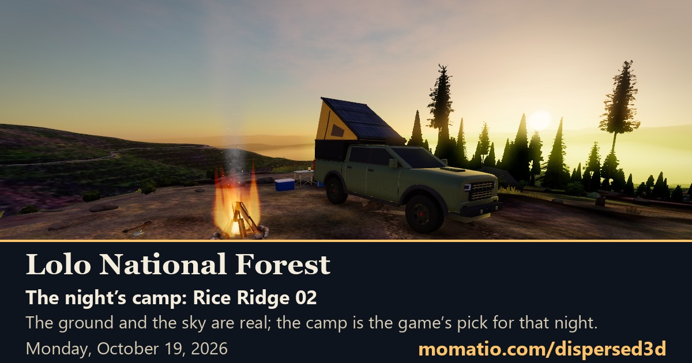</a>

# Dispersed 3D

**A free 3D overlanding game on real public land.** Drive the forest roads, pick a camp, and light a fire under tonight's real sky. It plays in your browser, on a phone or a computer.

<h2 align="center"><a href="https://momatio.com/dispersed3d/">Play it free</a> &nbsp;&nbsp;|&nbsp;&nbsp; <a href="https://momatio.com/dispersed3d/try">Try the preview</a></h2>

The preview is the next version, with the newest things in it before they go live.

New here? On the opening card, tap **Show me a night**. The game drives itself for 90 seconds and ends at a lit fire.

## What's real

This is a game laid over real places, and the real places do most of the work. Here is where each part comes from.

| What you see | Where it comes from |
|---|---|
| The ground | USGS 3DEP lidar elevation, about 1 meter close to the camps |
| The photograph on the ground | USGS NAIP aerial imagery. The color of a place is the photograph's color |
| The roads | The USGS road map, with the Forest Service's own road numbers, surfaces, maintenance levels and open dates where the agency records them |
| The creeks | The USGS NHDPlus HR stream map, and the USGS stream gauge's newest reading where one sits on a camp's named water |
| The wetlands on the map | The U.S. Fish and Wildlife Service's National Wetlands Inventory, mapped from aerial photographs. The edges are approximate |
| Peak names | GNIS, the federal place-name record |
| Tonight's weather and sky cover | The National Weather Service hourly forecast |
| Smoke | NOAA's satellite smoke maps |
| The Sun, the Moon and the stars | Computed for the place and the hour. The stars are the Yale Bright Star Catalogue; the Milky Way sits where the galactic plane really is |
| The campsites | [American Adventurer's](https://davelalande.com/map) public camping data: what the record says about cost, season, stay limits, rules and water |
| The campfire sound | A CC0 recording of a real campfire, by SKrafft on Freesound |
| The grain of the ground up close | CC0 ground photographs from Poly Haven and ambientCG |

**And plainly, what is the game's own:** the truck, the tent and the walk, the shapes of the clouds, the trees (placed where the photograph shows forest, but not one is a real tree), the grass, the rocks and stumps, the fire, the fuel and water in the rig, and the pictures the game draws for you to share. Where a record says nothing, the game says nothing. No cost on record does not mean free. The game has an About page that says all of this with the numbers.

## What's new

**October 19, 2026, afternoon: Fixes from an AI's playtest, and a lighter game for computers with no graphics card**

- An AI player played a four-night trip on Custer Gallatin overnight and wrote down everything that tripped it up; these are its fixes
- Night chores show what is done: each line has a check box, a ticked line says "done", and the card says plainly that ticking a chore spends its minutes on the game clock, once
- The morning reads like morning: the morning card is about last night's camp, with no advice about tonight's wind, and Real right now says "The sky now" by day and "Forecast for the coming night" from 6 AM to 6 PM
- Headlights go off after a night's sleep, and if they are on in full daylight one line says how to turn them off
- The road under the wheels has its real name: up Hyalite Canyon it said "Fowler Ln", a town street's name the street map carries along the Forest Service road. It now says Forest road 62
- The map keeps camp names apart: on a phone it names up to five camps instead of one, never on top of each other or the truck, with your goal camp and the camps you slept at named first
- Tonight's camp is a free camp whenever the forest has one, never a fee campground
- A computer that draws the 3D without a graphics card now opens the lighter game phones already get: fewer trees and a smaller photograph. Help, Settings puts the full game back

[Every release, in the changelog](https://github.com/davelalande/dispersed3d-progress/blob/main/CHANGELOG.md)

## Pictures

<table>
<tr>
<td width="50%" valign="top">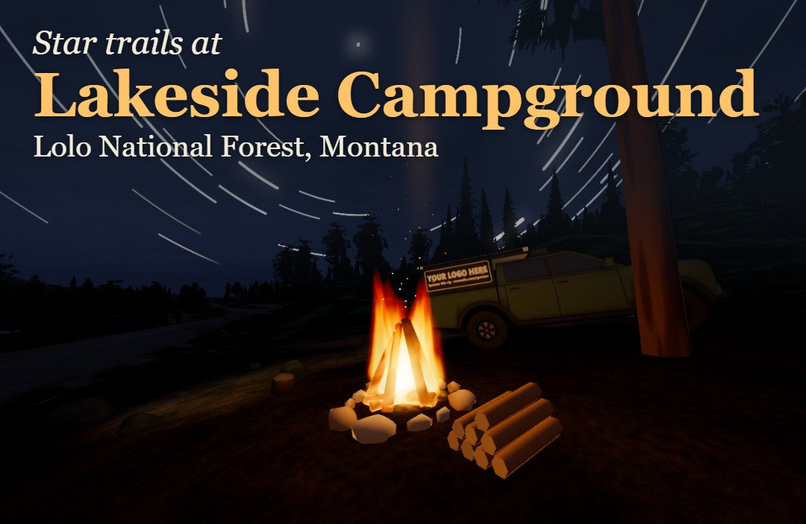 Star trails at Lakeside Campground, Lolo National Forest: an hour of the real sky in one picture.</td>
<td width="50%" valign="top">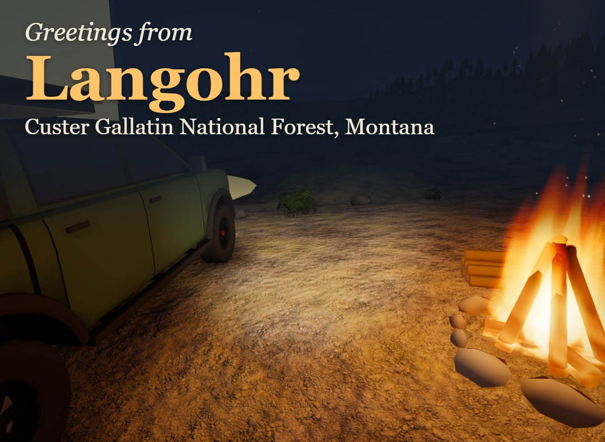 The postcard from Langohr, Custer Gallatin National Forest: your camp, under tonight's sky.</td>
</tr>
<tr>
<td width="50%" valign="top">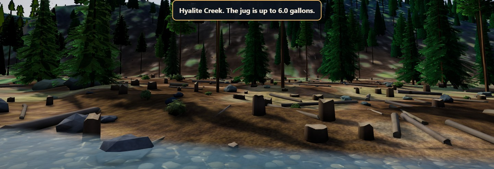 Hyalite Creek in the Custer Gallatin National Forest. Walk to the real creek and fill the jug.</td>
<td width="50%" valign="top">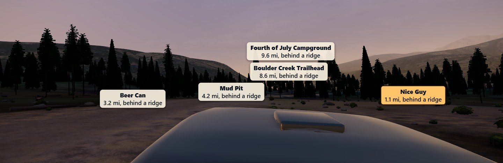 Dusk in the Beaverhead-Deerlodge National Forest, with the camps ahead named from the public record.</td>
</tr>
<tr>
<td width="50%" valign="top">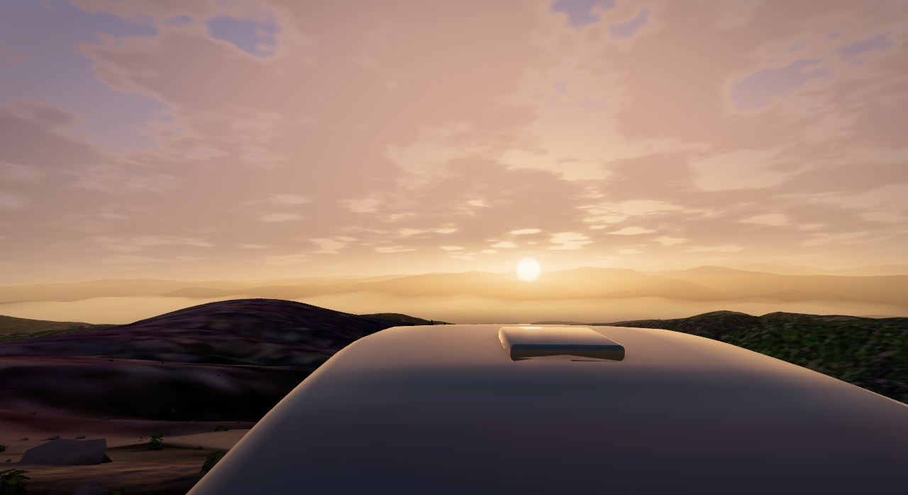 Sunset over the hills, with clouds in the sky.</td>
<td width="50%" valign="top">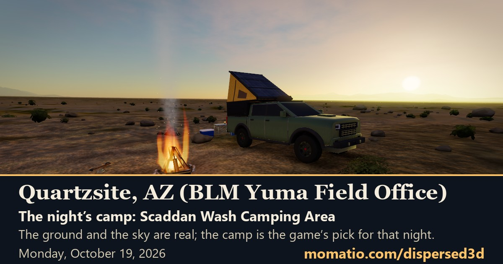 Quartzsite, Arizona: the desert world, at tonight's camp near sunset.</td>
</tr>
<tr><td width="50%" valign="top">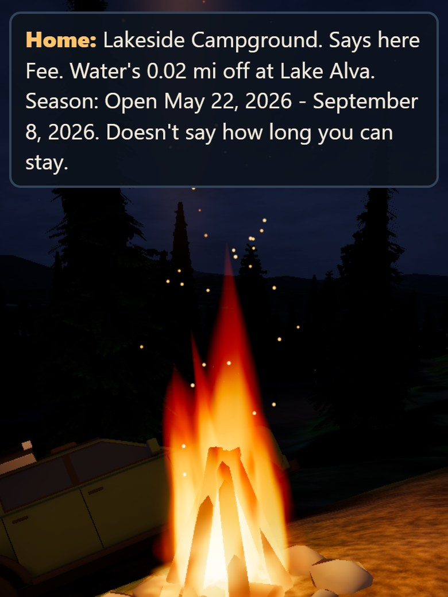 The fire at Lakeside Campground, on a phone.</td><td width="50%" valign="middle">It plays on a phone, with a thumbstick on the screen and a drawer of buttons you pull up, and on a computer, where the mouse steers with no click.</td></tr>
</table>

## Built in the open: the Asset Lab

Some of the things you see in the game, like the road-number posts at the forks, come from **[Momatio's Asset Lab](https://momatio.com/assets/)**: an AI agent writes a Blender script for each model, renders it, looks at its own renders, fixes what is wrong, and a person reviews the result. Every step is recorded, so you can spin each model and **watch it being made**. Nothing is bought, scanned or copied: each model is built from scratch by its script.

## The four forests

Each one has its own page with a picture of tonight's camp near sunset. The picture is made fresh each day.

<table>
<tr><td width="240"><a href="https://momatio.com/dispersed3d/share/lolo-national-forest.html">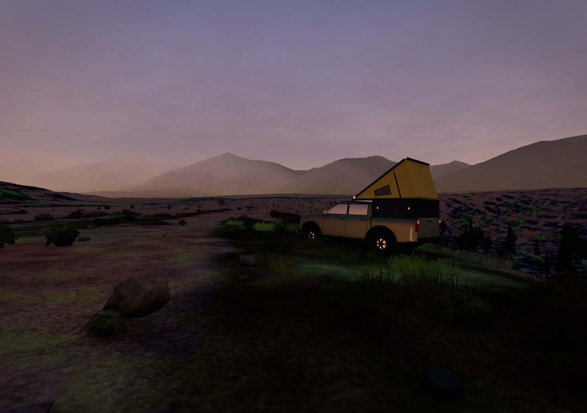</a></td><td valign="middle"><strong>Lolo National Forest</strong>, Montana <a href="https://momatio.com/dispersed3d/share/lolo-national-forest.html">Tonight's camp, as a picture</a> &nbsp;|&nbsp; <a href="https://momatio.com/dispersed3d/">Play it</a></td></tr>
<tr><td width="240"><a href="https://momatio.com/dispersed3d/share/custer-gallatin-national-forest.html">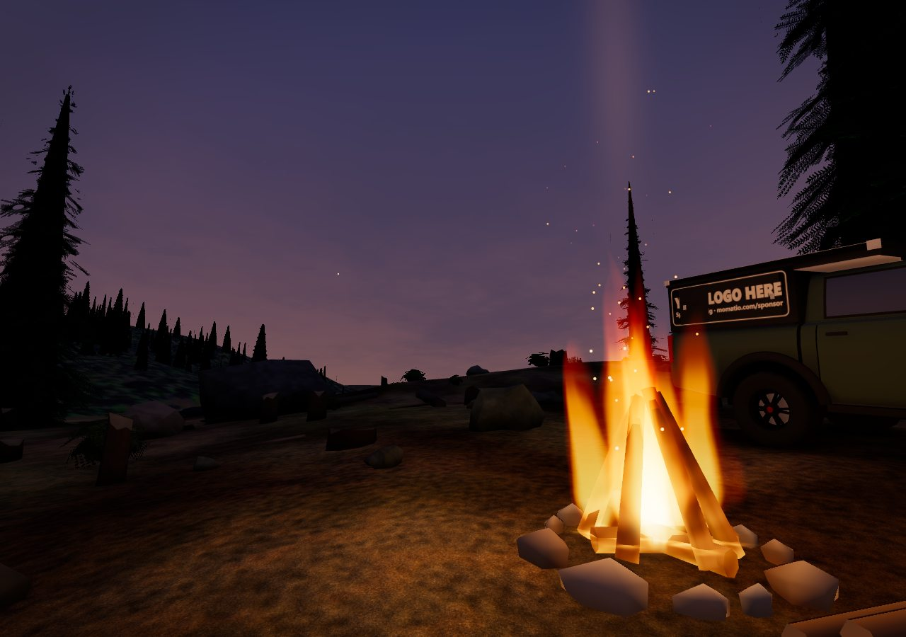</a></td><td valign="middle"><strong>Custer Gallatin National Forest</strong>, Montana <a href="https://momatio.com/dispersed3d/share/custer-gallatin-national-forest.html">Tonight's camp, as a picture</a> &nbsp;|&nbsp; <a href="https://momatio.com/dispersed3d/">Play it</a></td></tr>
<tr><td width="240"><a href="https://momatio.com/dispersed3d/share/beaverhead-deerlodge-national-forest.html">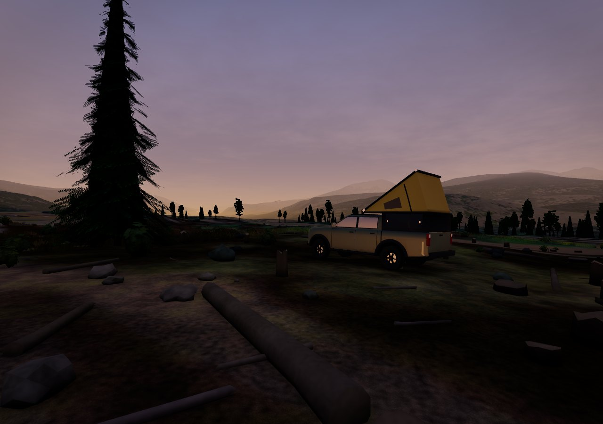</a></td><td valign="middle"><strong>Beaverhead-Deerlodge National Forest</strong>, Montana <a href="https://momatio.com/dispersed3d/share/beaverhead-deerlodge-national-forest.html">Tonight's camp, as a picture</a> &nbsp;|&nbsp; <a href="https://momatio.com/dispersed3d/">Play it</a></td></tr>
<tr><td width="240"><a href="https://momatio.com/dispersed3d/share/quartzsite-yuma-field-office.html">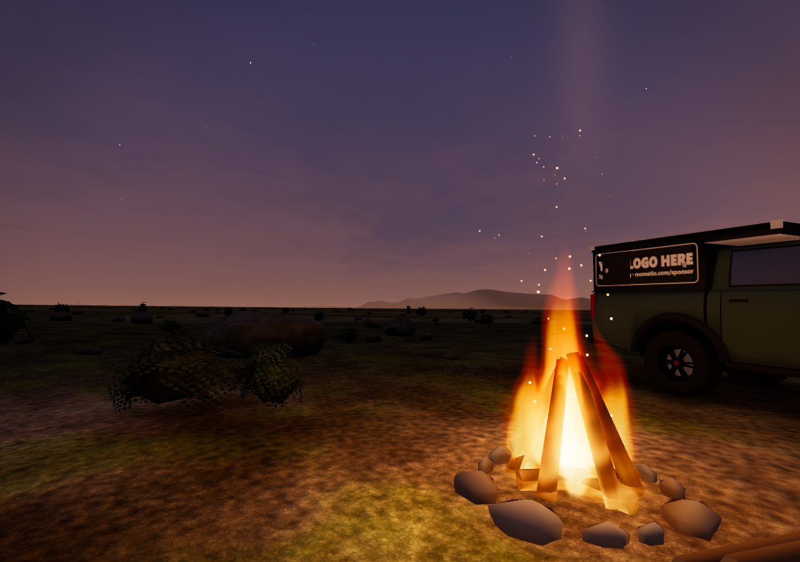</a></td><td valign="middle"><strong>Quartzsite, BLM Yuma Field Office</strong>, Arizona <a href="https://momatio.com/dispersed3d/share/quartzsite-yuma-field-office.html">Tonight's camp, as a picture</a> &nbsp;|&nbsp; <a href="https://momatio.com/dispersed3d/">Play it</a></td></tr>
</table>

## Where it's headed

**Up next**

**Ideas we're weighing** (nothing is built until we decide)

- Smaller, faster photos on phones
- Wildlife: a deer or an elk at dusk
- Read this card aloud, in the phone's own voice

[The whole roadmap](https://github.com/davelalande/dispersed3d-progress/blob/main/ROADMAP.md)

## Tell us

Got an idea, or did something break? Say what you'd like, or what happened, and what you were playing on. No code needed.

- [Tell us an idea](https://github.com/davelalande/dispersed3d-progress/issues/new?template=idea.yml)
- [Report a bug](https://github.com/davelalande/dispersed3d-progress/issues/new?template=bug.yml)
- [See what others have said](https://github.com/davelalande/dispersed3d-progress/issues)

---

Dispersed 3D is made by Momatio. © 2026 Momatio. All rights reserved. This repository holds the project's progress, not its source code.
